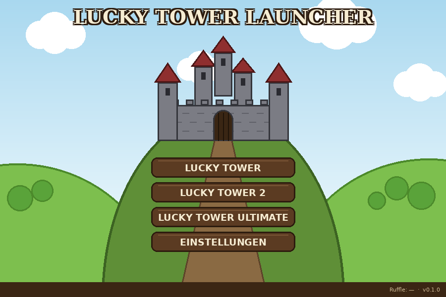

# Lucky Tower Speedrun Helper

Official speedrun launcher for the **Lucky Tower** series, maintained by the moderators of the
[Lucky Tower speedrun.com board](https://www.speedrun.com/series/Lucky_Tower_Series).

It launches **only the game versions approved for runs**. Every Flash file is checked by SHA-256 hash before it starts,
and the Flash games run in a fixed version of [Ruffle](https://github.com/ruffle-rs/ruffle).



[](https://github.com/BlwLeon/Lucky-Tower-Speedrun-Helper/releases/latest)

[](LICENSE)

> The interface is available in **English** (default) and **German**. Switch it under *Settings → Language*.

## Platform support

Version 1.0 officially supports **Windows (64-bit)** only. That is the only platform with a pinned and verified Ruffle build.

**Need macOS or Linux?** Please [open an issue](https://github.com/BlwLeon/Lucky-Tower-Speedrun-Helper/issues/new) or contact the board moderators. Other operating systems will gladly be supported on request: we only need to pin and verify the Ruffle build for that platform. The source code already runs on macOS and Linux.

## Supported games

| Game | Version used | Runs in |
|---|---|---|
| Lucky Tower | Official Newgrounds release (downloaded on first start) | Ruffle |
| Lucky Tower 2 – Glitch (QMS) | Community patch `swf/lt2_qms.swf` (bundled) | Ruffle |
| Lucky Tower 2 – Glitchless | Unpatched original from Flashpoint `swf/lt2_glitchless.swf` (bundled) | Ruffle |
| Lucky Tower Ultimate | Your Steam installation (App 1700270) | Steam |
| Lucky Tower – **Practice** | Practice build with debug bar `swf/lt1_practice.swf` (bundled) | Ruffle |
| Lucky Tower 2 – **Practice** | Practice build `swf/lt2_practice.swf` (bundled) | Ruffle |

> **Practice versions are for practicing only.** They let you warp to any room to practice strats, along with other QoL features.
> **Runs played on a practice version are invalid.** The launcher shows a warning before every practice start, and the launch log marks these starts with `"practice": true`.

## Features

- **Hash-locked versions**: The SHA-256 of every approved SWF is pinned in [`games.json`](games.json). Files that do not match are refused.
  Unpinned files are refused too. Players cannot add, re-pin or override versions (see [Official vs. developer mode](#official-vs-developer-mode)).
- **Pinned Ruffle**: The Ruffle build named in `games.json` (`ruffle_tag`) is downloaded from GitHub and checked against GitHub's checksum.
  The executable is also verified against `ruffle_sha256` before every launch. A modified Ruffle is reinstalled automatically.
- **Steam detection** for Lucky Tower Ultimate across all Steam library folders. If the game is not installed, the launcher opens the store page.
- **One-click speedrun mod for Lucky Tower Ultimate**: **INSTALL / REPAIR SPEEDRUN MOD** installs [BepInEx 5](https://github.com/BepInEx/BepInEx) (x64) and the [LTU Speedrun Mod](https://github.com/MadMouse101/LTUSpeedrunMod) into the game folder. The mod is required for top 3 runs.
  Both are verified by SHA-256. The LTU page shows the mod status (installed ✓ / modified / missing) and lists any other BepInEx plugins, which are also written to the launch log.
- **Fullscreen option**: Settings → **FULLSCREEN: ON** starts Lucky Tower 1 & 2 in fullscreen (Ruffle `--fullscreen`).
- **Steam folder shortcut**: Settings → **STEAM FOLDER** opens the Lucky Tower Ultimate installation folder.
- **Launch log** (`launch_log.jsonl`): Each start records time, game, hash and Ruffle version, so moderators have something to check during verification.
- **Status bar**: Shows whether the game is running and the session time, and reports Ruffle errors with Ruffle's own output.
- **Practice versions** for Lucky Tower 1 & 2 (room warps, QoL). Separate blue button, warning before every start, marked in the launch log.
- **English / German interface**, switchable in the settings (the choice is remembered).
- **Diagnostics**: Errors are written to `crash.log`, clicks to `session.log`. If the UI freezes for more than 10 s, a thread dump goes to `crash_native.log`.
- Uses only the Python standard library.

## Installation (Windows)

1. Download **`LuckyTowerLauncher.exe`** from the [latest release](https://github.com/BlwLeon/Lucky-Tower-Speedrun-Helper/releases/latest).
2. Optional: compare its SHA-256 with `LuckyTowerLauncher.exe.sha256` from the same release (PowerShell: `Get-FileHash .\LuckyTowerLauncher.exe`).
3. Run it. No installation is needed. On first start, Ruffle is downloaded automatically (about 30 MB).

> The EXE is not code-signed, so Windows SmartScreen may show "Windows protected your PC". Click **More info → Run anyway**.
> Every release EXE is built by GitHub Actions directly from this repository ([workflow](.github/workflows/release.yml)).

**For runs, use the official EXE from the releases.** The launch log records whether the EXE or the source code was used.

### Running from source (moderators / development)

Requires Python 3.9+ (on Linux you may need `sudo apt install python3-tk`).

```
git clone https://github.com/BlwLeon/Lucky-Tower-Speedrun-Helper
cd Lucky-Tower-Speedrun-Helper
python launcher.py
```

### Build the EXE yourself

- Windows: `build_windows.bat` → `dist\LuckyTowerLauncher.exe`
- macOS / Linux: `./build.sh` → `dist/LuckyTowerLauncher`

Both scripts use PyInstaller and bundle `swf/` and `games.json` into the executable.
Official releases are built by the [release workflow](.github/workflows/release.yml) as soon as a GitHub release is published. It runs the tests, builds the EXE on Windows and attaches the EXE, its SHA-256 and the Ruffle mirror to the release.

## Official vs. developer mode

**Official mode (default)** is what runners use.
- Only the `games.json` built into the launcher counts. A newer one is accepted only from this repository's `main` branch, and only if every version in it is pinned.
- `games.json` files placed elsewhere, `settings.json` overrides, unpinned files and modified Ruffle builds are all ignored or refused.
- The settings page has no tools that change hashes.

**Developer mode** is for moderators only. Start it with `python launcher.py --dev` (or `LTL_DEV=1`).
- A red banner shows that it is not valid for runs.
- It enables **Export hashes**, Ruffle updates, local `games.json` files and `manifest_url`.
- Every start is recorded in `launch_log.jsonl` with `"mode"` and `"build"` (`exe` or `source`), so runs from developer mode or a modified source checkout are easy to spot.

## For moderators

### Approving a new or changed SWF

1. Put the file into `swf/` (e.g. `swf/lt2_qms.swf`).
2. Run `python pin_hashes.py`. It writes the new SHA-256 values into `games.json`.
3. Commit `swf/` and `games.json`, then build a new release.

For downloaded games (Lucky Tower 1) and new Ruffle versions, start the launcher in **developer mode** and use **Settings → Export hashes**.
It writes `games_pinned.json` with all SWF hashes, the Ruffle version and the Ruffle executable's hash for your platform. Copy the values into `games.json`.

### Rolling out changes without a new build

Merge the updated `games.json` into `main`. Official launchers load it from
`https://raw.githubusercontent.com/BlwLeon/Lucky-Tower-Speedrun-Helper/main/games.json` on start, as long as it is complete (every game and Ruffle pinned).
New *bundled* SWFs still need a new build.

### Manifest format

```json
{
  "manifest_version": 1,
  "ruffle_tag": "nightly-2026-11-14",
  "ruffle_sha256": { "windows-x86_64": "d1b8bcf5…" },
  "ruffle_mirror": { "windows-x86_64": "https://github.com/…/releases/download/v1.0.0/ruffle-…-windows-x86_64.zip" },
  "games": [
    {
      "id": "lt2_glitchless",
      "title": "Lucky Tower 2",
      "variant": "Glitchless",
      "label": "GLITCHLESS",
      "file": "swf/lt2_glitchless.swf",
      "url": null,
      "sha256": "0c455e25e19056397bb29d31b4701d44da95402b74779e86885f86646454574a",
      "ruffle_args": [],
      "source_note": "Unpatched original from BlueMaxima's Flashpoint"
    }
  ]
}
```

- `file`: bundled file, relative to the launcher.
- `url`: download source, used only if `file` is missing. At least one of `file` and `url` must be set.
- Entries with the same `title` are grouped on one page, one button each.
- `ruffle_args` are passed to Ruffle, for example to enforce rendering settings for runs.
- `ruffle_sha256`: hash of the Ruffle executable per platform (`windows-x86_64`, `macos-arm64`, `linux-x86_64`, …). Platforms without an entry still run, and the launch log marks them as unverified.
- `practice`: an optional, separate list of practice versions, using the same fields as `games`. They appear as a blue **PRACTICE** button on the page of the game with the same `title`.
  A pinned `sha256` is optional for these. `pin_hashes.py` pins them automatically, which catches broken files. They are kept separate from `games` so that launchers up to 1.0.1, which read the online manifest, ignore them.
- `ltu_mod`: the Lucky Tower Ultimate speedrun mod (optional, separate section, so launchers up to 1.1.0 ignore it):
  ```json
  "ltu_mod": {
    "bepinex": { "version": "5.4.23.5", "url": "https://github.com/BepInEx/BepInEx/releases/download/v5.4.23.5/BepInEx_win_x64_5.4.23.5.zip", "sha256": "82f98785…" },
    "mod": { "name": "LTU Speedrun Mod", "version": "1.0.1", "file": "mods/LTUSpeedrunMod.dll", "sha256": "…" }
  }
  ```
  Both hashes must be pinned. The installer checks that the game is a 64-bit Unity Mono build. It extracts BepInEx into the game folder and copies the mod to `BepInEx/plugins/`, disabling any duplicate older copies.
- `ruffle_mirror`: fallback download per platform, used if the pinned Ruffle release is no longer available on GitHub. It is used only when `ruffle_sha256` is pinned for that platform, so the binary is still verified.

## Data folder

| OS | Path |
|---|---|
| Windows | `%LOCALAPPDATA%\LuckyTowerLauncher` |
| macOS (source) | `~/Library/Application Support/LuckyTowerLauncher` |
| Linux (source) | `~/.local/share/LuckyTowerLauncher` |

It contains `ruffle/`, a download cache in `games/`, `settings.json` (incl. language), `launch_log.jsonl`, `session.log`, `crash.log` and `logs/` with Ruffle output.

## Reporting problems

Please [open an issue](https://github.com/BlwLeon/Lucky-Tower-Speedrun-Helper/issues/new) and attach `session.log`, `crash.log` and `crash_native.log` from the data folder (if present).

## Tests

```
python tests/test_flow.py
```

This end-to-end test runs on Linux and macOS. It uses a local HTTP server and a Tk mock to cover the Ruffle install, hash checks, tampered files, empty or broken SWFs, Ruffle errors, bundled files and `pin_hashes.py`.

## Limitations

The hash check makes sure runners start the approved files through the official launcher. It is not tamper-proof against someone who modifies the launcher itself.
Running from source is possible, but the launch log records it (`"build": "source"`), so moderators can require the official EXE for runs. It complements video verification and does not replace it.

## Credits & license

- Lucky Tower, Lucky Tower 2 and Lucky Tower Ultimate © Studio Seufz. The SWF files in `swf/` belong to their respective owners and are **not** covered by this repository's license. They are included only so runners can play the versions approved for the leaderboard.
- Flash emulation by [Ruffle](https://github.com/ruffle-rs/ruffle) (MIT / Apache-2.0), downloaded at runtime.
- [BepInEx](https://github.com/BepInEx/BepInEx) (LGPL-2.1), downloaded at runtime for the Lucky Tower Ultimate speedrun mod.
- [LTU Speedrun Mod](https://github.com/MadMouse101/LTUSpeedrunMod) by MadMouse101 (MIT), bundled in `mods/`.
- Launcher code: [MIT License](LICENSE).
